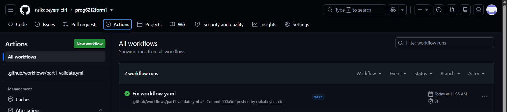

# RaceDay

RaceDay is a full-stack event management platform for South African road running,
walking, and cycling events. Organisers can create and manage events, categories,
and participant results. Participants can browse events, enter them, and track
their personal results and race history.

## Roles

- **Organiser** — creates and manages events, categories, and captures results.
- **Participant** — browses events, enters them, and tracks personal results.

## Part 1 — Planning

This part covers system planning only. No API code is written yet.

- `/docs/RaceDay_ERD.png` — entity relationship diagram
- `/docs/API_Endpoint_Plan.md` — full endpoint specification
- `/docs/RaceDay_Database.sql` — database creation and seed script

The SQL script matches the ERD exactly.

## CI/CD


## Video

_Unlisted YouTube link_

## AI disclosure


## Part 3: MVC web app

The MVC app is the front end for the Part 2 API. It has two roles. Organisers manage events, categories, entries and results. Participants browse events, enter, and see their results. Profile pictures and event banners are stored in Azure Blob Storage. The file goes from the MVC app to the API, the API saves it to Blob Storage, and the MVC app shows it from the blob address.

### What you need
- .NET 8 SDK
- Docker Desktop
- SQL Server running in Docker (see the Part 2 section)
- Azurite (Azure Storage emulator) or a real Azure Storage account

### Run it

1. Start SQL Server and Azurite:
   ```
   docker start racedaysql
   docker run -d --name azurite -p 10000:10000 mcr.microsoft.com/azure-storage/azurite azurite-blob --blobHost 0.0.0.0 --skipApiVersionCheck
   ```
2. Start the API from `Part2-API/RaceDay.Api` on `http://localhost:5080`:
   ```
   dotnet run --urls "http://0.0.0.0:5080"
   The API must listen on all addresses so the Docker container can reach it.
   ```
3. Build and run the MVC app in Docker:
   ```
   docker build -t raceday-web ./Part3-MVC
   docker run --rm -p 8080:8080 -e Api__BaseUrl=http://host.docker.internal:5080 raceday-web
   ```
4. Open `http://localhost:8080`.

To use real Azure instead of Azurite, set `BlobStorage:ConnectionString` in the API settings to your storage account connection string and turn on anonymous blob access for the account.

### Logins
All seed accounts use `Password123!`.

| Role | Email |
| --- | --- |
| Organiser | thabo.nkosi@raceday.co.za |
| Organiser | lindiwe.dube@raceday.co.za |
| Participant | sipho.mokoena@example.com |
| Participant | amahle.zulu@example.com |

New organisers register with the invite code `RACEDAY-ORGANISER-2026`.

### Screens
- Participant: upcoming events with filters, event details, Enter Event, my entries, my results, profile with picture
- Organiser: dashboard, events with banners, categories, entries, results

Statuses are colour coded: green is Confirmed, yellow is Pending, red is Cancelled.

### CI
`.github/workflows/part3-web-ci.yml` builds the MVC project and the Docker image on every push. The Part 2 workflow still builds and tests the API.


https://youtu.be/Hdu1GwlCsQU

### AI disclosure
I used Claude to help me with my commits on github desktop

